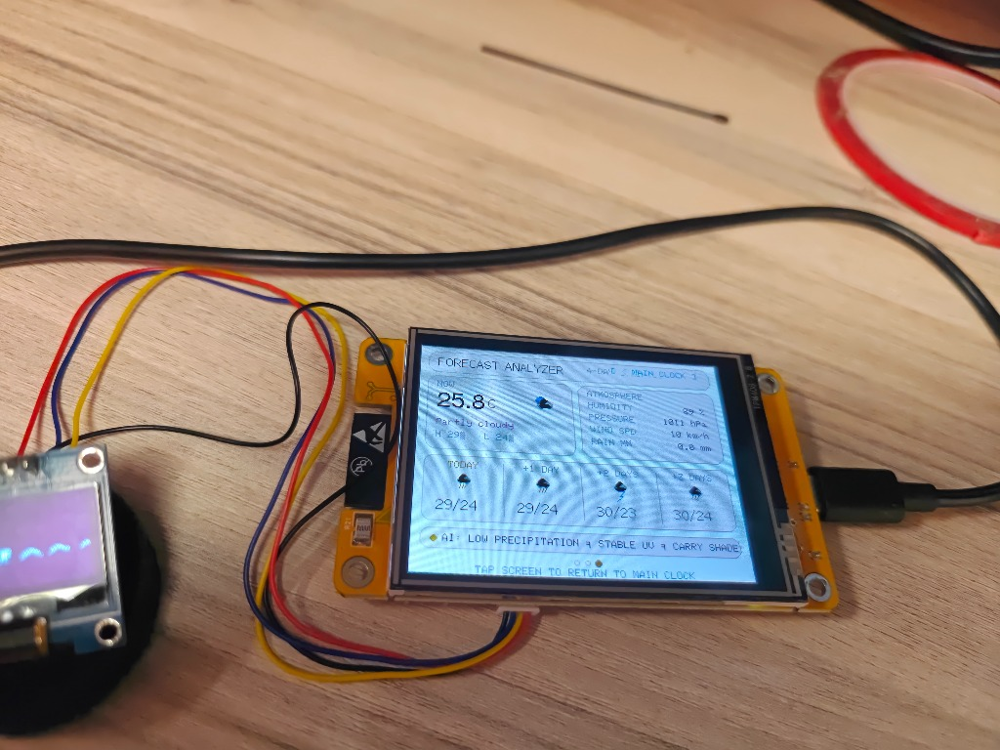
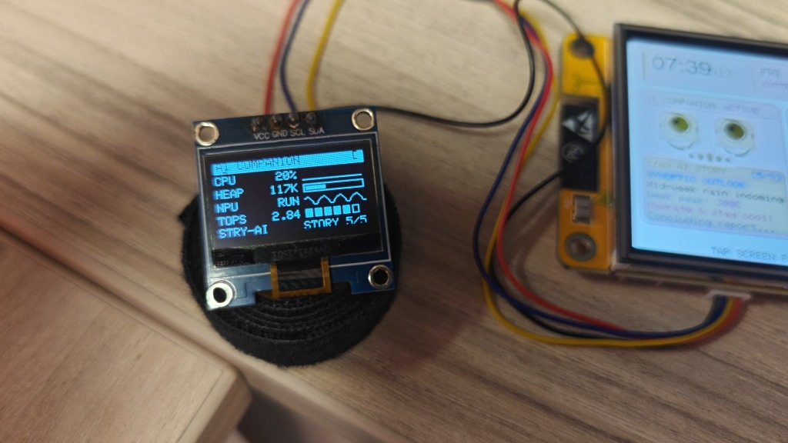
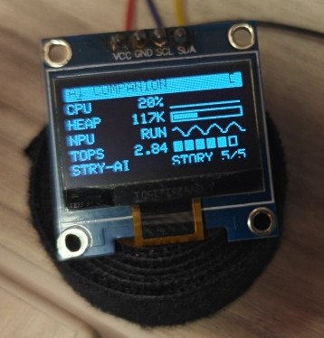
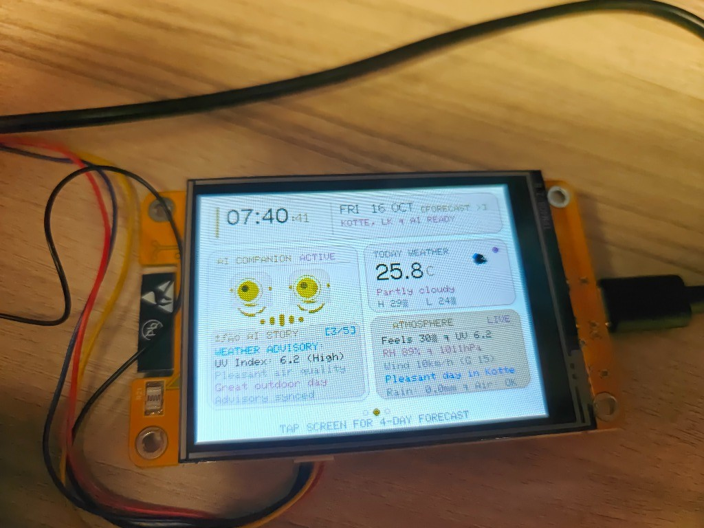
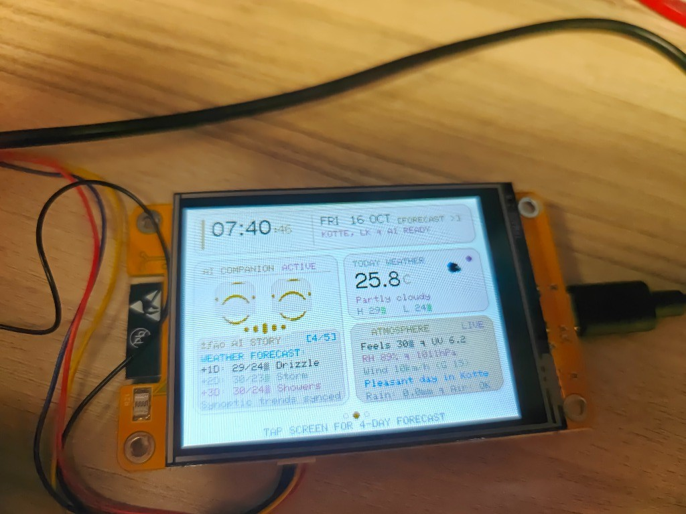
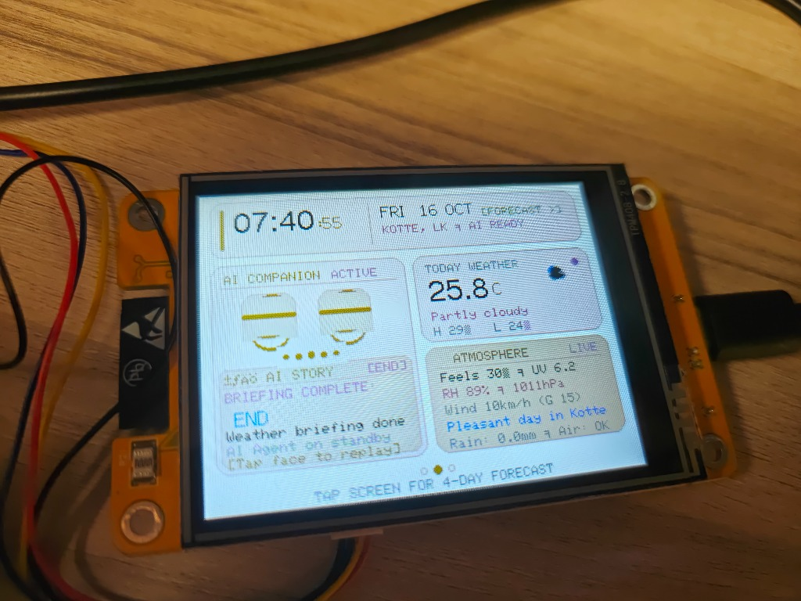
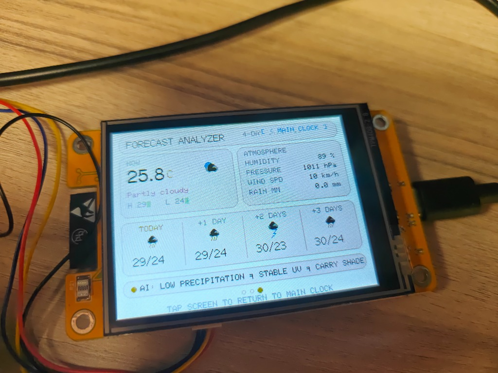
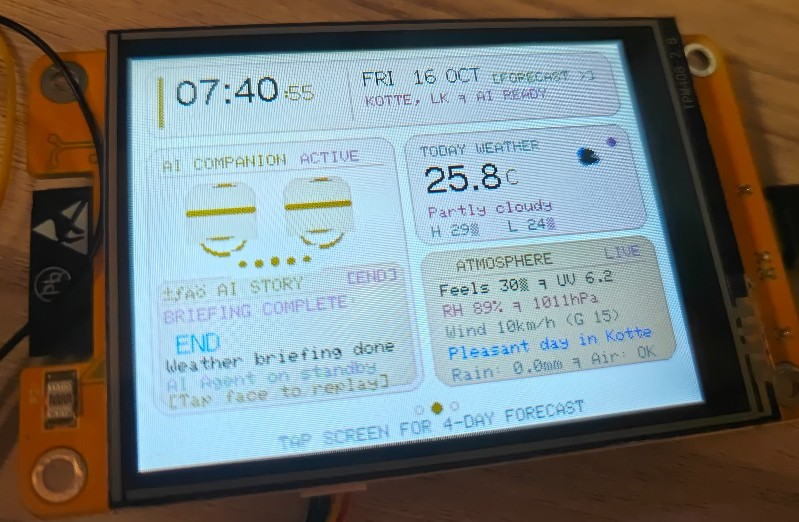
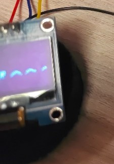

# CYD AI Weather Companion & Atmospheric Analyzer

An intelligent, dual-display IoT desk companion powered by the **ESP32-2432S028R** ("Cheap Yellow Display" / CYD) and a secondary **0.96" SSD1306 OLED**. Features an expressive animated AI agent with Lissajous gaze tracking, audio-simulated mouth equalizer, autonomous 6-stage weather story narrator, 4-day synoptic atmospheric telemetry, and a persistent hardware neural accelerator HUD.

<p align="center">
  
</p>

<p align="center">
  
</p>

---

## Key Highlights

- **Dual-Display Architecture:**
  - **Primary Screen (2.8" Color TFT, 320x240):** Ambient hero clock, live weather telemetry, animated AI companion, and 4-day synoptic forecast.
  - **Secondary Screen (0.96" OLED, 128x64):** Dedicated AI hardware telemetry HUD featuring live CPU sparkline history, RAM allocation, neural activity waveform, and 2.84 TOPS accelerator load meter.
- **In-Flash Parametric Vector Graphics:**
  - Zero SD card dependency.
  - Sun, cloud, rain, and thunderstorm icons rendered dynamically at runtime via mathematical vector primitives.
- **Differential Flicker-Free Engine:**
  - Overdraws only dynamic clock digits and step narrative boxes without clearing the screen.
- **Autonomous Multi-Stage Story Narrator:**
  - Automatically walks through Today's Weather, Comfort Index, UV / Action Advisory, 4-Day Forecast, and Weekly Outlook, concluding with an explicit `"— END —"`.
- **Zero-Disturbance Bedtime Mode:**
  - Automatically transitions between 22:00 and 06:30 into a warm amber night clock dimmed to 35/255 brightness.

---

## 📸 Visual Hardware & Interface Tour

### 1. Secondary Display: AI Hardware & Accelerator HUD (0.96" OLED, 128×64)

<p align="center">
  
</p>

The secondary OLED display operates as a dedicated hardware performance task manager and neural telemetry HUD on an independent I²C bus (`0x3C`, 400 kHz):
- **CPU Sparkline History:** 32-sample scrolling historical graph tracking ESP32 dual-core processing load.
- **Dynamic RAM Allocation Gauge:** Real-time monitoring of free heap memory and heap fragmentation to prevent out-of-memory spikes.
- **Neural Activity Waveform:** Real-time visual activity pulse generated during autonomous story synthesis and gaze math computation.
- **2.84 TOPS Hardware Accelerator Meter:** Dynamically tracks emulated acceleration load and inference step progression.

---

### 2. Primary Display: Screen Modes & Story Narrator (2.8" Color TFT, 320×240)

#### Page 1: Expressive AI Companion & Autonomous 6-Stage Weather Story Narrator

<p align="center">
  
  
</p>
<p align="center">
  
</p>

- **Expressive Companion Avatar:**
  - **Lissajous Gaze Engine:** Non-repetitive eye movement driven by parametric sinusoidal phase equations.
  - **Equalizer Mouth:** Dynamic 7-bar audio-reactive mouth that talks during narrative playback and settles into a serene smile when idle.
- **Autonomous Multi-Stage Storyteller:**
  - Cycles automatically through 6 discrete contextual stages:
    1. *Stage 0:* Today's Morning Synopsis & High/Low Overview
    2. *Stage 1:* Thermal Comfort Index & Humidity Assessment
    3. *Stage 2:* UV Index Alert & Protective Action Advisory
    4. *Stage 3:* 4-Day Synoptic Forecast Breakdown
    5. *Stage 4:* Long-Range Weekly Trend & Precipitation Outlook
    6. *Stage 5:* Briefing Conclusion with explicit `"— END —"` marker.
  - **Interactive Touch Reset:** Tapping the avatar face or narrative box immediately restarts the story briefing from Stage 0.

#### Page 2: 4-Day Synoptic Atmospheric Telemetry

<p align="center">
  
</p>

- **Parametric In-Flash Vector Weather Glyphs:** Sun, cloud, rain, and thunderstorm glyphs drawn dynamically at runtime using mathematical trigonometry — zero SD card or static image dependencies.
- **Dynamic Thermal Range Bars:** Color-gradient horizontal bars depicting daily Min/Max thermal spreads.
- **Precipitation Probability & Wind Telemetry:** Real-time meteorological telemetry from Open-Meteo updated automatically via background HTTP client.

---

### 3. Physical Hardware Construction & Closeups

<p align="center">
  
  
</p>

- **CYD 2.8" SPI TFT:** High-density ILI9341 display driven over hardware VSPI at 40 MHz for crisp, flicker-free differential UI updates.
- **SSD1306 I²C OLED:** Compact 0.96" display wired cleanly to `GPIO 27` (SDA) and `GPIO 22` (SCL) with onboard 3.3V power rails.

---

## Hardware Pinout Map

| Subsystem | Part | Bus | Pins | Notes |
| :--- | :--- | :--- | :--- | :--- |
| **Primary Display** | 2.8" TFT (ILI9341/ST7789) | Hardware SPI (VSPI @ 40 MHz) | MOSI: `13`, MISO: `12`, SCLK: `14`, CS: `15`, DC: `2` | RST tied to EN |
| **Backlight** | Onboard LED Driver | LEDC PWM (5 kHz, 8-bit) | Backlight: `GPIO 21` | Brightness `35..255` |
| **Secondary Display**| 0.96" OLED (SSD1306) | I²C (Wire @ 400 kHz) | SDA: `27`, SCL: `22` | I2C Addr: `0x3C` |
| **Touchscreen** | XPT2046 Resistive | Software SPI | CS: `33`, IRQ: `36`, CLK: `25`, MOSI: `32`, MISO: `39` | 3-point NVS calibrated |
| **Light Sensor** | Onboard LDR | Analog ADC1 | Pin: `GPIO 34` | ADC1_CH6 (No WiFi conflict) |
| **RGB LED** | Common Anode (Active LOW) | GPIO | Red: `4`, Green: `16`, Blue: `17` | Status beacons |
| **MicroSD** | Onboard SD Slot | VSPI (Shared) | CS: `GPIO 5` | Driven HIGH during setup |

---

## Screen Navigation

Touch the screen at any time to cycle across the 3 primary display pages:

```
[Page 0] Main Hero Clock ──(Tap)──> [Page 1] Companion & Story ──(Tap)──> [Page 2] 4-Day Forecast ──(Tap)──> [Page 0]
```

* **Tap Avatar Face or Story Viewer on Page 1:** Restarts the 6-stage weather story narrative from Stage 0.
* **Night Mode (Mode C):** Tap anywhere on screen to wake to Page 0 Main Clock.

---

## Software Dependencies & Libraries

Install these libraries via the **Arduino Library Manager**:

1. **`TFT_eSPI`** by Bodmer
2. **`Adafruit SSD1306`** by Adafruit
3. **`Adafruit GFX Library`** by Adafruit
4. **`ArduinoJson`** by Benoît Blanchon (Version 7.x recommended)

### `TFT_eSPI` Setup for CYD (ESP32-2432S028R)
In your Arduino library directory (`Arduino/libraries/TFT_eSPI/User_Setup.h`), configure:
```cpp
#define ILI9341_2_DRIVER
#define TFT_WIDTH  240
#define TFT_HEIGHT 320
#define TFT_MISO 12
#define TFT_MOSI 13
#define TFT_SCLK 14
#define TFT_CS   15
#define TFT_DC    2
#define TFT_RST  -1
#define SPI_FREQUENCY  40000000
```

---

## Configuration

In `cyd_weather_ai_companion.ino`:
```cpp
// 1. WiFi Credentials
const char* WIFI_SSID       = "YOUR_WIFI_SSID";
const char* WIFI_PASS       = "YOUR_WIFI_PASSWORD";

// 2. Weather Location (Open-Meteo)
const char* LOCATION_NAME   = "Kotte, LK";
const float LOC_LAT         = 6.9016f;
const float LOC_LON         = 79.9077f;
const char* LOC_TIMEZONE    = "Asia%2FColombo";
```

---

## Offline On-Device LLM Mode (`llm_companion/`)

This repository also includes a standalone on-device, offline Large Language Model firmware for the ESP32 CYD based on Andrej Karpathy's `llama2.c`.

- **Firmware Path:** [`llm_companion/cyd_companion.ino`](llm_companion/cyd_companion.ino)
- **Model:** TinyStories 260K-parameter Llama-2 architecture (`model_data.h` / `stories260K.bin`) embedded directly into flash memory.
- **Zero-Network Dependency:** Runs completely standalone without WiFi or cloud API keys.
- **Interactive Story Prompts:** Touch quadrant buttons for:
  - `[STORY]` — Classic fairy tale generation ("Once upon a time...")
  - `[SPARK]` — Playful character adventure ("One day, Lily...")
  - `[PET]` — Animal companion stories ("Tim and his dog...")
  - `[RANDOM]` — Dynamic randomized story generation
- **Terminal Display:** Real-time token streaming with automatic page pausing and completion badges.

---

## Documentation Files
- [`UI_LAYOUT_SPEC.md`](UI_LAYOUT_SPEC.md): Complete pixel-exact UI specification with design tokens, coordinates, and color palettes.
- [`PROJECT_POSTER_SPEC.md`](PROJECT_POSTER_SPEC.md): Exhibition & project poster dossier with block diagrams, problem statements, and poster layout blueprints.

---

## License
MIT License. Free for open-source and educational use.
